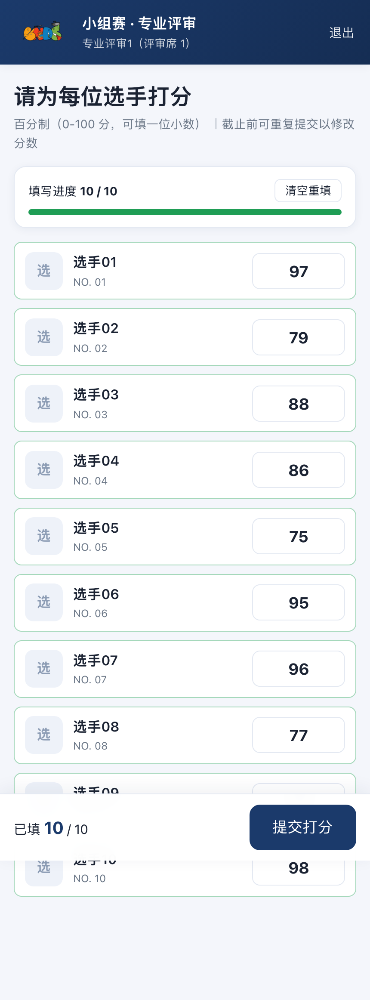
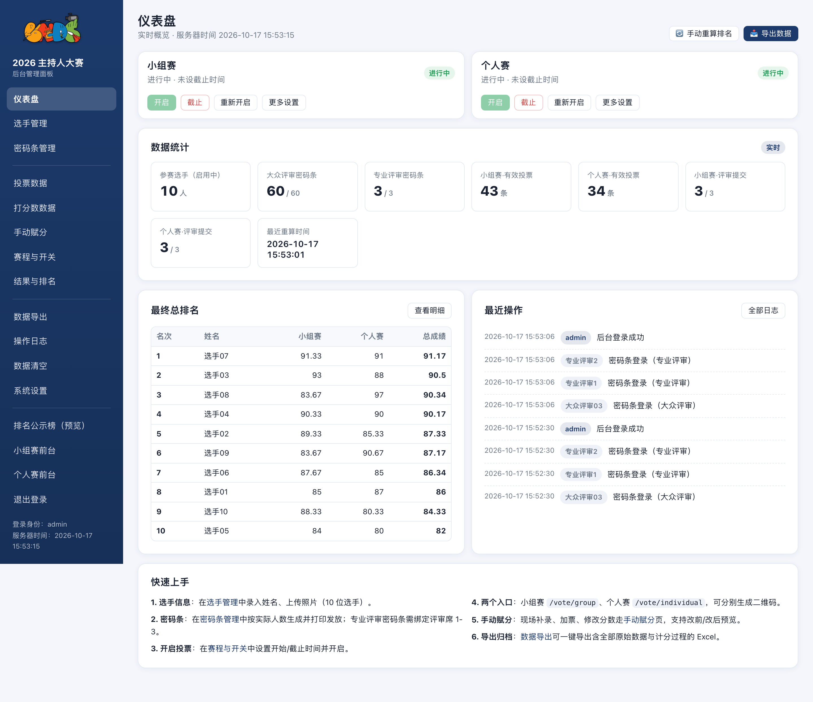
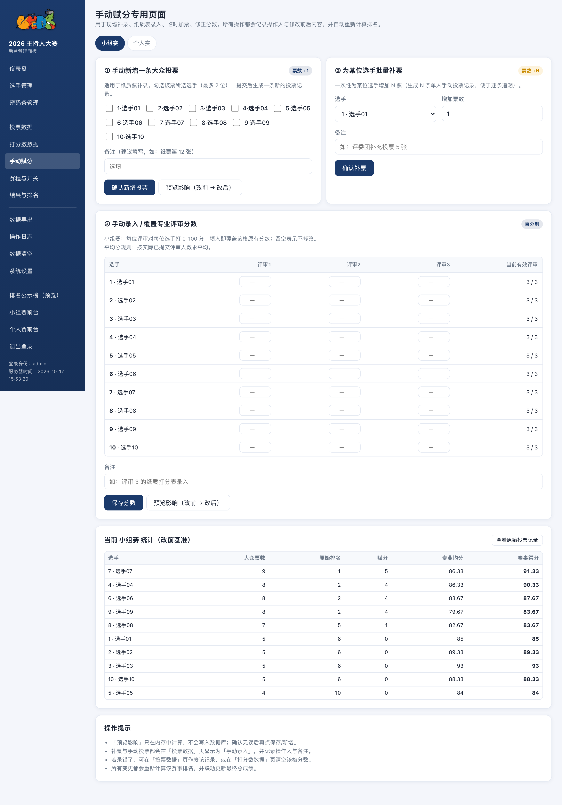
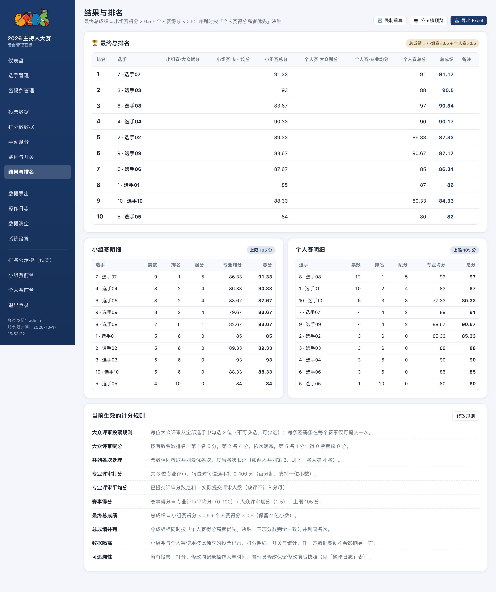
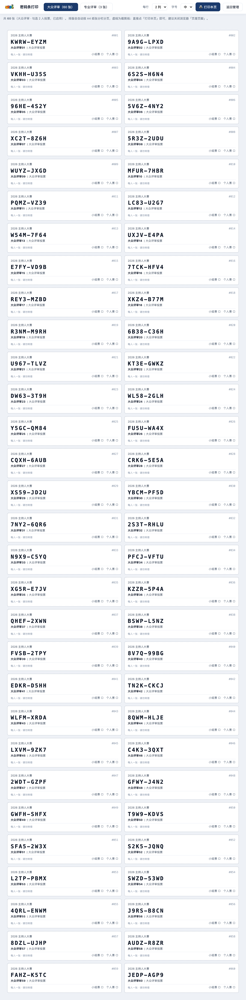

# 2026 BNDS 校园主持人大赛 · 投票系统

> 双投票入口 + 密码条双权限 + 自动计分排名 + 全过程可复核导出
> Node.js + Fastify + SQLite（使用 Node 内置 `node:sqlite`，**零原生依赖**，服务器上不需要编译任何东西）

> ### ⚠️ 本仓库是脱敏版
> 真实活动的**选手姓名、选手照片、密码条、投票明细、打分明细、运行日志、服务器地址与凭据**均已移除。
> 仓库内的数据库与报表是 **`scripts/seed-demo.mjs` 随机生成的演示数据**，与任何真实活动无关。
> 脱敏清单见 [`说明（脱敏版）.md`](说明（脱敏版）.md)。

---

## 截图

| 移动端 · 大众评审投票 | 移动端 · 专业评审打分 |
|---|---|
|  |  |

| 后台 · 仪表盘 | 后台 · 手动赋分与影响预览 |
|---|---|
|  |  |

| 后台 · 结果与排名 | 密码条打印（自动排版） |
|---|---|
|  |  |

---

## 需求背景

一场校园比赛，选手分**两场**（小组赛与个人赛）分别投票计分。需要一个现场用手机投票、
后台可人工干预、赛后能导出可复核数据的系统。

参赛人数、每票可选几位、评分方式、两场权重等规则全部由后台配置，系统不内置固定规则。

## 功能

### 前台（投票）

| 路径 | 用途 |
|---|---|
| `/vote/group` | **小组赛**投票入口（独立 URL / 二维码） |
| `/vote/individual` | **个人赛**投票入口（独立 URL / 二维码） |
| `/board` | 排名公示榜 —— 严格由后台开关控制，未开启时任何人（含管理员）访问都返回 403 |
| `/logout` | 退出（中性结束页，无任何入口链接） |
| `/healthz` | 健康检查 |
| `/` | 刻意返回 404 —— 不提供"入口选择页" |

- **登录方式**：输入密码条（一人一条，即身份凭证），密码条在后台绑定权限类型
- **两个人赛入口相互隔离**：页面内不出现任何跨环节跳转，避免选手串场
- 投票页移动端优先：卡片式选手列表、勾满后其余自动置灰、底部固定提交、二次确认
- 专业评审打分页：支持草稿本地保存、进度条、截止前可重复提交修改

### 后台（`/manage`）

仪表盘 · 选手管理（含照片上传）· 密码条管理（一键生成/打印）· 投票数据 · 打分数数据 ·
手动赋分（**改前/改后影响预览**）· 赛程开关（到点自动截止）· 结果与排名 · 数据导出 ·
操作日志（全部修改留痕）· 数据清空（密码二次确认）· 系统设置

后台所有按钮都是**原地提交**：右下角浮层提示、只局部刷新受影响的区块，不跳转、不清空已填内容。

### 计分（规则全部可配置）

系统提供**投票制**（按得票排名换算赋分）与**评分制**（评审打分后取平均）两类计分，
相加得到每场得分，再按可配置权重加权得到总成绩。

以下参数均在后台「系统设置」中调整，代码中不含固定规则：

| 参数 | 说明 |
|---|---|
| 每票可勾选人数 | 每位投票人最多可选几位选手（可少选，不可多选） |
| 赋分梯度 | 第 1 名得多少分，之后逐名递减 |
| 评审人数 | 每场设置几个评审席 |
| 缺评处理 | 按实际提交人数平均 / 缺评记 0 分后除以总人数 |
| 得分上限 | 每场得分的封顶值 |
| 两场权重 | 如 0.5 / 0.5，按场次加权求和 |
| 并列处理 | 并列取最优名次 / 取平均名次 |
| 总成绩并列决胜 | 按某场得分优先等 |

### 导出的"透明性"

`/manage/export/full` 生成的 Excel 含 **11 个工作表**，结论与推导过程并列，可手工复算任意一个数字：

最终总排名 / 说明与规则 / 小组赛-计分过程 / 个人赛-计分过程 / 总成绩计算过程 /
原始数据-大众投票明细 / 原始数据-专业评审打分 / 原始数据-密码条清单 / 原始数据-选手名单 /
操作日志 / 统计摘要

其中「计分过程」把每一步中间量单独列成列（原始票数、名次、赋分、各评审打分、有效评审数、
平均分、封顶前后得分等），便于逐格复算。

---

## 技术栈

| 层 | 选型 | 说明 |
|---|---|---|
| 运行时 | Node.js 22+ | 单进程即可支撑数百人并发 |
| 后端 | Fastify 5 | 轻量、插件化 |
| 数据库 | SQLite（`node:sqlite` 内置，WAL 模式） | **零原生依赖**，无需编译 better-sqlite3 |
| 模板 | EJS 服务端渲染 | 无构建步骤，首屏快 |
| 前端 | 原生 JS + 手写 CSS | 无框架依赖 |
| 导出 | exceljs | 多工作表、样式 |
| 图片 | 原生 multipart 上传 | 不依赖 sharp |
| 部署 | systemd + Nginx | 应用只监听 127.0.0.1，Nginx 同时监听 80 与 8080 |

## 快速开始

```bash
npm install
HV_ADMIN_PASS='你的密码' npm start
# 打开 http://127.0.0.1:3000/vote/group
```

首次启动会自动建表、创建 10 位占位选手、生成密码条与管理员账号，
初始凭据写入 `data/INITIAL_ADMIN.txt` 与 `data/INITIAL_CODES.txt`。

想要一份带演示数据的现成环境：

```bash
node scripts/seed-demo.mjs          # 生成 demo-data/hostvote.db（随机票数与打分）
HV_DATA_DIR=./demo-data HV_ADMIN_PASS=demo123456 npm start
```

## 测试

```bash
npm test                        # 计分引擎单元测试（15 项）
node scripts/audit.mjs          # 深度审计：投票/计分/一致性/安全边界（100+ 项，仅限本地）
node scripts/e2e.mjs            # 端到端验收（130+ 项）
node scripts/ui-check.mjs       # 浏览器交互检查（12 项，需本机 Chrome）
node scripts/doctor.mjs         # 数据体检，--fix 可清理孤儿数据
node scripts/loadtest.mjs       # 并发压测（自动造数据并清理）
```

## 目录

```
server.js             服务入口
src/                  后端逻辑
  config.js           路径/端口/环境变量
  db.js               建表、种子数据、系统设置
  repo.js             数据访问、事务、结果落库
  services.js         业务规则：投票、打分、手动赋分、数据修正
  scoring.js          计分引擎（纯函数，可单测）
  auth.js             密码条登录、管理员登录与锁定、会话
  routes-public.js    前台路由
  routes-manage.js    后台路由
  exporter.js         Excel 导出（11 个工作表）
views/                EJS 模板
public/               样式与前端脚本
scripts/              测试与运维脚本
deploy/               nginx / systemd / 部署脚本
test/                 单元测试
01-示例数据/          示例数据库（随机演示数据）
02-示例报表/          从示例库导出的 Excel
04-配置/              nginx、systemd、cron 配置示例
07-文档/              运维手册、部署记录
```

## 设计上的一些取舍

- **密码条即身份**：现场没有账号体系，一人一张密码条最简单可靠；后台可随时停用、重置投票状态
- **同步 SQLite + 单线程**：业务量级（数百人）下反而最稳，写入串行天然避免竞态
- **结果表是派生数据**：任何改动都触发全量重算（幂等），避免增量累加带来的误差累积
- **导出即证据**：所有中间量都写进 Excel，现场被质疑名次时可以当场复算

## 许可证

代码以 [MIT License](LICENSE) 开源。其中赛事名称、Logo 等标识归其权利人所有。

本项目最初为一场校园活动的内部工具，因需求明确且实现方式可复用，整理为脱敏版后公开供参考。
